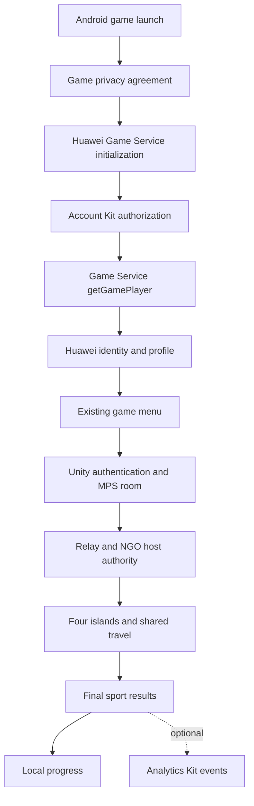

# Huawei Game Service integration and competition publishing

Research date: **14 October 2026**, Malaysia time. Project: **WHATTHE FISH?**

Use **current Huawei Game Service initialization and game sign-in with Account Kit** as the first integration milestone. Keep the existing Unity multiplayer rooms and four-island gameplay. Add Analytics Kit only if it provides useful demonstration evidence and fits the measured APK budget.

**Do not plan Huawei achievements, leaderboards or cloud saves using old Game Service tutorials.** Huawei removed saved games in SDK 6.13.0.300 on 30 May 2024, then removed achievements, event reporting and leaderboards in SDK 6.14.0.300 on 27 September 2024. The current release notes list 6.14.0.300 and require HMS Core (APK) 6.12.0.300 or later. Installing an older wrapper does not restore an online service. [Huawei version history](https://developer.huawei.com/consumer/en/doc/HMSCore-Guides/version-change-history-0000001050123471)

This is a development proposal. The game currently has no working Huawei integration, and SDK compatibility and package growth need a fresh Android build and physical-device testing.

## Competition requirements

The supplied event is the **UMPSA x HUAWEI GameCenter Mobile App Competition 2026**. Category B is for undergraduate university, polytechnic and diploma students. Its poster requires a digital Android mobile game using **Huawei Mobile Services (HMS)**; it does not specify Game Service alone, a minimum number of kits, or mandatory public AppGallery publication.

The Category B submission includes a PowerPoint presentation of at most **40 slides**, game files of at most **100 MB**, and a demo video of at most **3 minutes within 60 MB**, with English subtitles for non-English videos. Teams have at most three members, each person belongs to one team, and members come from the same institution. Our repository deliberately uses the stricter delivery rule of an APK **below 100,000,000 bytes**. [Official Category B poster](https://www.uxhmac.com/img/banners/category_b.png)

The website lists registration closing **13 October at 11:59 PM**, briefing **15 October**, mobile services workshop **16–18 October**, final submission **1 November at 11:59 PM UTC+8**, preliminary judging **2–9 November**, and the top-ten finale **25 November**. Confirm the team's registration and use the briefing to settle the technical acceptance criteria. [Official competition timeline](https://www.uxhmac.com/)

Resolve these questions at the briefing or workshop:

- Does demonstrated Game Service initialization plus game sign-in satisfy the HMS requirement? Are additional kits scored or required?
- Must an entry be publicly released, approved for open testing, or simply supplied as a signed APK? Is an AppGallery application ID or listing URL required?
- Does the entry use Huawei's joint operations program, and therefore require a `.huawei` package suffix?
- Which phone models, OS versions, HMS Core versions and network access will judges use? Can judges supply their own Huawei IDs?
- Are anonymous/offline Android entry paths permitted under the intended distribution arrangement? What evidence proves integration?

These are unresolved acceptance details, not reasons to delay the registration and build compatibility work.

## What the Huawei products mean

| Product | Role in this project |
|---|---|
| HMS Core | Huawei's collection of device and service SDK capabilities, with a separate installed runtime on supported Android devices. |
| Game Service | Game launch initialization, Huawei game sign-in, floating window, game update, addiction prevention and GameTurbo Engine integration. |
| Account Kit | Supplies Huawei ID authorization used before Game Service obtains the game player identity. |
| AppGallery Connect | Developer console for the app record, API activation, certificate fingerprints, configuration, testing and release management. |
| AppGallery | Store through which the approved Android release reaches users. |
| GameCenter | Huawei's game ecosystem and the event partner; do not treat the event name as a separate multiplayer SDK requirement. |

The current Game Service introduction lists the supported game capabilities above and supports Huawei and non-Huawei phones/tablets subject to the platform/runtime requirements. Regional availability follows Account Kit. Its February 2026 notice explicitly confirms the retired features, despite the older marketing overview still advertising them. Use the development guide and release notes for implementation decisions. [Current service introduction](https://developer.huawei.com/consumer/en/doc/HMSCore-Guides/introduction-0000001050121216)

For this Android competition, test Android/EMUI-compatible devices. Confirm the judging OS rather than assuming all Huawei devices run this APK; native HarmonyOS development is a separate platform path.

## How the services fit the current game

The inspected project uses Unity **6000.3.20f1**, IL2CPP, ARM64 and minimum Android API **26**. Its development package is `com.umpsa.whatthefish`. Custom Android Gradle templates are currently disabled and there is no `Game/Assets/Plugins/Android` integration directory.

[Models.cs](../Game/Assets/_Game/Shared/Core/Models.cs) contains an unused `IPlatformGameServices` boundary with only `Available` and `ReportResult(string, int)`. `HuaweiServicesPlaceholder` returns false and logs that integration is not configured. There are no runtime calls wiring that placeholder into authentication or results. [RoomService.cs](../Game/Assets/_Game/Shared/Networking/RoomService.cs) separately initializes Unity Gaming Services, signs in anonymously, and creates or joins Multiplayer Services sessions with Relay. NGO owns the host and client gameplay connection.

The integration should add a Huawei account layer while preserving **four islands, one active game per host room, and everyone travelling together**. Game Service's current capability list supplies no replacement for our physics synchronization, Relay transport or room authority. Replacing that working multiplayer system would add unrelated implementation and testing work.

**Huawei game identity and Unity multiplayer identity remain separate.** A Huawei `openId` is not automatically a Unity Authentication credential. Initially, keep Unity's existing transport identity and associate Huawei identity with the local profile. Any persistent account linking or cross-device progress should use a backend that verifies Huawei authorization and applies an explicit mapping. Never transmit authorization tokens through ordinary room snapshots.

## Recommended feature scope

| Priority | Feature | Benefit and implementation boundary |
|---|---|---|
| First | Game launch initialization and Huawei game sign-in | A real supported HMS integration with visible authorization and game player retrieval. Display a signed-in profile state in the menu. |
| First | Lifecycle and failure handling | Handle consent rejection, cancellation, expired authorization, missing/old HMS Core, network loss and app resume without freezing or repeated pop-ups. |
| Next, if useful | Analytics Kit | Demonstrate which sport players choose, start and finish; use the data to improve tutorials and session flow. |
| Optional game feature | Local achievement book | Examples: first catch, finish five Golf cups, win a Football or Basketball match, visit four islands. These are our own features, not Huawei achievement APIs. |
| Later | Backend progress and public rankings | Needs persistence, score validation, abuse controls and additional operational scope. Existing room rankings can remain local to the current match. |
| Later | GameTurbo Engine | Investigate only with real Huawei performance measurements and any required Huawei API permissions. |

Analytics Kit is a separate service that supports custom behavior events. It remains a possible route for telemetry after the retirement of Game Service event reporting. Proposed events are `sport_selected`, `tutorial_completed`, `match_started` and `match_completed`, with sport, mode, duration preset, human count and bot count. Do not send Huawei tokens, raw identity values or room codes as event parameters. [Analytics Kit capabilities](https://developer.huawei.com/consumer/en/hms/huawei-analyticskit/)

Count local progress once per finalized match and per participating human player. Attach it to the authoritative finish transition in `FootballMatch`, `BasketballMatch`, `GolfMatchManager` and `FishingGame`, after reviewing each sport's final-result behavior. Separate online human matches from bot matches and practice. Host authority reduces accidental client errors but does not make a player-hosted score tamper-proof; public competitive rankings would need stronger validation. Keep global rankings out of the first competition milestone unless the rules demand them.

## Development approach

### Choose a Unity integration route

| Route | Assessment |
|---|---|
| A workshop-supported Unity wrapper | Prefer it if Huawei can demonstrate current Game Service APIs on Unity 6, ARM64 and the project's actual Gradle toolchain. Pin its version and inspect its dependency list. |
| Existing general HMS Unity plugins | Useful references, but do not import their complete samples or assume current API support. EvilMindDevs lists Unity 2019–2021 support; Unity's Huawei sample says Unity 2020 or higher. Neither statement establishes tested compatibility with this Unity 6 project or removal of obsolete APIs. |
| A small Android Java/Kotlin bridge | Recommended fallback: expose only the current launch, authorization, player retrieval and lifecycle calls through a C# adapter. It gives control over dependency scope, but requires native callback and Android lifecycle work. |

These compatibility limits come from the maintainers' documentation. [EvilMindDevs plugin](https://github.com/EvilMindDevs/hms-unity-plugin), [Unity Huawei sample](https://github.com/Unity-Technologies/HuaweiServiceSample)

Unity 6.3 supports calling Java/Kotlin plug-ins from C# through its Android JNI APIs. Use `AndroidJavaClass`/`AndroidJavaObject` and an explicit callback bridge; return Unity UI work to Unity's main thread. Verify which launch Activity Unity generates before adapting `onActivityResult`, Application initialization and pause/resume behavior. A bridge can be Java source or an AAR; it does not require another game engine. [Unity 6.3 Android plug-in documentation](https://docs.unity3d.com/6000.3/Documentation/Manual/android-plugins-java-code-from-c-sharp.html)

### Register and configure the app

1. Choose a durable developer account owned by the team or institution, register as a Huawei developer and complete identity verification.
2. Create an AppGallery Connect project and an **Android / Game** app. Finalize the publishing package identifier before configuring SDK credentials.
3. Register the **SHA-256 signing certificate fingerprint** in Project settings. Cover the certificate of the APK actually being tested and the eventual distributed signing certificate.
4. Enable **Game Service** and **Account Kit** in Manage APIs. Enable Analytics only if selected for the scope.

Huawei documents the verified developer, Game category, fingerprint and API activation prerequisites. [AppGallery Connect preparations](https://developer.huawei.com/consumer/en/doc/HMSCore-Guides/config-agc-0000001281025916)

Huawei's pre-release checklist requires a package ending in `.huawei` or `.HUAWEI` **for a joint operations game**. Settle whether that arrangement applies before choosing between the current development ID and a distinct Huawei publishing variant; do not rename the project solely because Huawei sponsors the competition. The same checklist checks certificate/signature consistency, launch order, lifecycle and resource shrinking. [Game pre-release checklist](https://developer.huawei.com/consumer/en/doc/HMSCore-Guides/pre-release-check-0000001050121544)

Keep keystores, passwords and client secrets outside Git and outside the shipped client. Treat `agconnect-services.json` as application configuration, inspect its contents, and supply it through the selected integration's documented build process. The downloadable configuration is not a place to put server credentials.

### Integrate the Android dependencies

Add Huawei's Maven repository and the current Game Service/Account dependencies to Unity's generated Gradle structure through maintained templates or a deterministic postprocessor. The current guide names `com.huawei.hms:game:6.14.0.300` and `com.huawei.hms:hwid`; obtain a compatible Account Kit and AGConnect plugin version when implementing, then pin them. Its Android Studio instructions place `agconnect-services.json` in the app module. A Unity wrapper may copy it from a different source location, so inspect the exported Gradle project rather than blindly copying an old `StreamingAssets` tutorial. [HMS SDK integration guide](https://developer.huawei.com/consumer/en/doc/HMSCore-Guides/integrate-as-sdk-0000001050435953)

Keep Unity's supported SDK/NDK/JDK/Gradle combination. Old codelab values are examples, not instructions to downgrade Unity 6. Select only Account and Game Service initially, with their required transitive dependencies. Do not add IAP merely because an example includes it. Audit merged manifests, native libraries, duplicate classes, shrinker rules and final DEX/resources. A smaller direct bridge is a hypothesis until the actual APK is measured.

### Implement the supported launch and sign-in sequence

At game launch, present our privacy agreement when applicable, then initialize the Huawei SDK. Register Huawei's Application lifecycle support and call `JosAppsClient.init(AppParams)`. Initialize before sign-in and handle the Huawei consent screen. Rejected consent must not be treated as successful initialization. Do not retry endlessly on network failure. [Game initialization guide](https://developer.huawei.com/consumer/en/doc/HMSCore-Guides/game-start-0000001050123475)

After initialization succeeds, authorize using Account Kit with the **game scope** and an authorization code. Attempt silent authorization, then show interactive authorization when appropriate. After authorization succeeds, call `PlayersClient.getGamePlayer()`. Use the `openId` from that **Game Service Player**, not the Account Kit authorization object. The current guide gates game entry on successful player retrieval and describes server verification using the authorization code. Cancellation must not start another automatic sign-in loop. [Game sign-in guide](https://developer.huawei.com/consumer/en/doc/HMSCore-Guides/game-login-0000001050121526)

For the AppGallery game route, implement those gates explicitly. Keep Windows development playable with an unavailable platform adapter. Confirm the intended Android offline/guest policy with Huawei before retaining an entry path that bypasses the documented game authorization gate. A network error or denied consent must never produce a fake signed-in state.

Expand the platform boundary into asynchronous initialization and sign-in operations, a small identity object, explicit states such as initializing/authorized/error, and a capability query. Wire it into `AppRoot` and the menu. Do not implement the existing `ReportResult` method by calling removed Huawei ranking APIs. Keep local progress and optional Analytics as separate responsibilities.

For verified production identities, use a backend to exchange/verify authorization and compare the returned game identifier. Never embed a client secret in the APK, and do not claim a client-provided ID has been server-verified. Mainland identity verification, addiction prevention and `savePlayerRole` have additional regional requirements; the current sign-in guide says role reporting is available only in the Chinese mainland. Start with the competition's intended Malaysia distribution and resolve any expansion separately.

## Testing and APK budget

At the start of this research, `Builds/Android/WhatTheFish-release.apk` measured **91,700,774 bytes**, matching the opening [release record](BUILD-SIZE.md). That baseline leaves **8,299,226 bytes to the 100,000,000-byte boundary**, so an integer-byte addition of at most **8,299,225** would still satisfy the strict rule. It exceeds the **75,000,000-byte development target by 16,700,774 bytes**.

The artifact changed during this documentation task: the first readiness run found no APK at that path, and the subsequent run observed **91,634,440 bytes**, with **8,365,560 bytes to the hard boundary** and **16,634,440 bytes above the working target**. This task did not build or functionally validate that replacement; the difference of **-66,334 bytes** is not an HMS integration delta. Neither observation validates an HMS-integrated build.

First produce an initialization/sign-in spike with no new art, ads, IAP or cloud database dependencies. Measure the final APK delta, inspect `Builds/SizeAudit/latest/`, remove unintended dependencies, and investigate supported resource/language filtering and shrinking. Preserve mandatory Huawei resources and test release builds after shrinking. Continue asset/dependency optimization toward the 75 MB working target; the remaining 8.3 MB is not a comfortable development reserve.

| Check | Required evidence |
|---|---|
| First install and authorization | A real Huawei phone shows privacy/authorization and successful `getGamePlayer`; profile state matches the current user. |
| Return launch and account changes | Silent authorization and renewal behave correctly; switching/revoking authorization cannot retain the previous profile. |
| Failure states | Denied consent, canceled sign-in, old/missing HMS Core and network loss leave responsive, truthful UI with deliberate retry. |
| Android lifecycle | Background/foreground, authorization Activity return and any floating window behave correctly; no repeated dialogs or callback loss. |
| Existing gameplay | Host and guest can join, travel together, play and finish all four sports; only one match runs per room. |
| Release packaging | IL2CPP ARM64, signing fingerprint, config, merged manifest and release shrinker behavior pass on the exact submission APK. |
| Optional Analytics | A consented real-device session produces the intended events in the Huawei console, with no sensitive payloads. |
| Performance and size | Physical-phone touch, appearance, FPS/thermal behavior, WAN play and exact APK bytes are recorded. |

After feature checks, run `Tools/Build/Build.ps1 -Target AndroidSubmission`, inspect the audit and update the size records. Promote the complete validated Windows player to `Builds/WindowsFinal/` for a delivered gameplay change, including its build record. Run `Tools/Build/Check-TaskReady.ps1 -RequireApk`. Windows tests can verify the fallback adapter and gameplay; they do not establish Huawei phone compatibility or performance.

## Publishing to AppGallery

Huawei's Android release flow covers the APK, release territories, localized listing/assets, age rating, privacy information, AI content declaration, review information and release scheduling. Mobile APK uploads need 64-bit support. Mainland game publication approval is a separate regional requirement. Huawei states review usually takes **one to three working days**, which is not a guaranteed completion time. [Android APK release guide](https://developer.huawei.com/consumer/en/doc/distribution/app/agc-help-releaseapkrpk-0000001106463276)

Prepare the following release material alongside implementation:

1. A tested, signed release APK with the final identifier, increasing version code, matching certificate configuration and recorded hash.
2. The game name, description, icon, screenshots and contact details, consistent with the shipped game. Check whether the punctuation in WHATTHE FISH? is accepted in the listing.
3. Accurate age-rating answers and privacy disclosures covering Huawei account/services, Unity multiplayer, and optional Analytics. Provide a reachable privacy policy and a practical contact/process for data rights.
4. Asset licenses/provenance and an accurate AI content declaration for generated assets or services. Match declarations to the actual package and selected territories.
5. Reviewer instructions covering authorization, solo play, host/join and four-island travel. Keep backend services available during review and supply test access when requested.
6. Open testing or public release as required by the organizer, leaving time for rejection fixes and another review.

The review guidelines require accurate information, stable functionality, usable test access, valid contacts and an available service during review. [AppGallery review guidelines](https://developer.huawei.com/consumer/en/doc/50104-overview)

Do not equate competition submission, an uploaded draft, approval for testing and a public store release. Each has different evidence. A signed self-contained competition APK remains subject to our strict byte limit even if store distribution uses another format.

## Proposed schedule and judging demonstration

| Malaysia dates | Proposed milestone |
|---|---|
| 14–15 October | Confirm registration, account ownership, kit acceptance, publication status, package suffix and judging devices. |
| 16–18 October | Attend the workshop; prove current initialization/sign-in on Unity 6 and a phone; measure SDK growth. |
| 19–23 October | Finish menu/account state, lifecycle, identity handling and existing-room regression checks. Add Analytics only if justified. |
| 24–27 October | Complete phone QA and store materials; submit the required testing/release version early. |
| 28–31 October | Resolve review feedback, freeze the tested APK and prepare slides and the compressed demo. |
| 1 November | Submit the exact APK, presentation and video before 11:59 PM UTC+8. |

This schedule is a team planning estimate, not a Huawei delivery promise. Developer verification, native wrapper compatibility, device availability, SDK size and any required store approval are the critical dependencies.

Suggested three-minute demo: show Huawei authorization and the signed-in state; create/join a room; show shared island travel and a short sport sequence; finish with final results and, if implemented, the corresponding Analytics console evidence. Allocate about 25 seconds to account integration, 100 seconds to the game, 35 seconds to services evidence and 20 seconds to the value proposition. Present real integration evidence and label local achievements/rankings accurately.

## Research verification

The competition poster and current Huawei documentation were read directly, including rendered document pages where web extraction omitted their content. The retirement finding is corroborated by both the current service introduction and SDK version history. Repository inspection covered platform stubs, multiplayer initialization, Android settings and the existing APK. No runtime code, SDK package, signing setup or build setting was changed for this research; an HMS-integrated APK size remains **unverified** until implementation and a fresh build.
